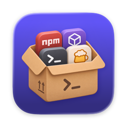

<div align="center">
  
  <h1>Cellar</h1>
  <p>Gérez les outils de développement de votre Mac dans une seule app native.</p>
  <p>
    <a href="../README.md">English</a> ·
    <a href="README.zh-CN.md">简体中文</a> ·
    <a href="README.zh-TW.md">繁體中文</a> ·
    <a href="README.ja.md">日本語</a> ·
    <a href="README.ko.md">한국어</a> ·
    <a href="README.de.md">Deutsch</a> ·
    <strong>Français</strong> ·
    <a href="README.es.md">Español</a>
  </p>
</div>

Cellar regroupe les logiciels Homebrew, les paquets npm globaux, les versions de Node.js et la configuration du terminal dans une seule app macOS. Consultez les logiciels installés, trouvez les outils dont vous avez besoin, mettez-les à jour et vérifiez ce qui sera supprimé avant une désinstallation.

> [!NOTE]
> Cellar 1.0 n'est pas encore disponible publiquement. Aucun programme d'installation ni Cask Homebrew n'est proposé pour le moment. Vous pouvez compiler l'app depuis les sources ; les vérifications en environnement réel et la validation de l'interface restent à effectuer.

## Ce que vous pouvez faire

| Tâche | Dans Cellar |
|---|---|
| Vérifier votre environnement | Consultez l'état de Homebrew, Node.js, npm, nvm et du terminal sur la page d'accueil. |
| Gérer les logiciels installés | Parcourez, recherchez et filtrez les Formulae et Casks Homebrew ainsi que les paquets npm globaux dans la bibliothèque. Mettez à jour un élément ou un lot filtré, et désinstallez les éléments individuellement. |
| Trouver de nouveaux outils | Recherchez dans Homebrew et npm sur la page de découverte pour installer un élément, ou installez un lot de paquets du même type dans Maintenance. |
| Configurer votre environnement | Gérez les versions globales de Node.js avec nvm, les taps Homebrew, les registres npm, ainsi que les thèmes et plugins Oh My Zsh. |
| Vérifier et nettoyer | Lancez les diagnostics Homebrew, la vérification du cache npm et les installations par lot, puis examinez les tâches de nettoyage prises en charge pour les caches, les versions inutilisées de Node et les anciens journaux Manager. |

La progression des tâches et leurs résultats récents restent visibles lorsque vous changez de page, y compris les résultats individuels lorsqu'un lot ne réussit que partiellement.

L'interface prend en charge **l'anglais, le chinois simplifié, le chinois traditionnel, le japonais, le coréen, l'allemand, le français et l'espagnol**. Le réglage par défaut est **Suivre le système**. Vous pouvez choisir une langue dans Réglages > Général ; ce changement redémarre Cellar.

## Configuration requise et disponibilité

- **macOS 26 ou ultérieur**, sur un **Mac avec puce Apple** (`arm64`).
- **Xcode 26 ou ultérieur** pour compiler depuis les sources.
- Homebrew, Node.js, npm et nvm sont des outils gérés par Cellar ; ils ne sont pas fournis avec l'app.

Si les Command Line Tools ou Homebrew sont absents, Cellar peut ouvrir la procédure d'installation du système. Le paquet d'installation officiel de Homebrew est vérifié avant son ouverture. Pour nvm, Cellar fournit des instructions d'installation.

Sparkle est configuré pour les mises à jour de l'app via le [tap Homebrew partagé](https://github.com/SlippinDylan/homebrew-tap). Le flux de mises à jour signé et le Cask seront créés lors de la première publication correspondante. Les mises à jour de l'app sont désactivées dans les compilations Debug et les compilations locales ordinaires.

## Compiler depuis les sources

```bash
git clone https://github.com/SlippinDylan/Cellar.git
cd Cellar
open Cellar.xcodeproj
```

Dans Xcode, sélectionnez le schéma **Cellar**, **My Mac** et la configuration **Debug**, puis appuyez sur **⌘R**. Debug utilise une signature ad hoc locale (Sign to Run Locally) : il n'est donc pas nécessaire de vous connecter à un compte développeur Apple ni d'installer un certificat de signature.

Pour compiler en ligne de commande :

```bash
xcodebuild build \
  -project Cellar.xcodeproj \
  -scheme Cellar \
  -configuration Debug \
  -destination 'platform=macOS,arch=arm64' \
  -derivedDataPath build/DerivedData-Debug
```

L'app compilée se trouve dans `build/DerivedData-Debug/Build/Products/Debug/Cellar.app`. Consultez le [guide de développement](development.md) pour les tests, la signature et les compilations Release.

## Avant de modifier votre environnement

- Les paquets npm globaux appartiennent à une installation précise de Node.js. Les recherches et les opérations utilisent l'environnement Node sélectionné ; Cellar ne gère pas les dépendances npm locales aux projets.
- La recherche et la modification de paquets npm nécessitent une installation nvm prise en charge ; les autres installations Node détectées restent lisibles. Les paramètres utilisateur du registre et la maintenance du cache conservent leurs propres conditions. Les URL de registre acceptent HTTPS sans identifiants et HTTP local sur `localhost`, `127.0.0.1` ou `[::1]` ; les autres adresses HTTP ne sont pas prises en charge.
- Changer la version de Node utilisée par Cellar n'affecte que la session Cellar en cours, pas les terminaux déjà ouverts. Cellar gère les environnements Node/npm globaux plutôt que les fichiers `.nvmrc` par projet.
- Les installations et mises à jour individuelles de paquets depuis les cartes de la bibliothèque et de la page de découverte démarrent directement. L'installation de composants du terminal, les opérations par lot, les désinstallations, les nettoyages et les changements de configuration demandent de confirmer leur périmètre. Les tâches en cours ne peuvent pas être arrêtées manuellement, et Cellar empêche de quitter l'app pendant leur exécution.
- La désinstallation des Casks Homebrew peut aussi supprimer les données associées confirmées au préalable et dont l'appartenance à la cible est vérifiable. Les données partagées ou non vérifiées sont conservées. Les désinstallations de Formulae et de paquets npm n'incluent pas ce nettoyage des données associées. Cellar n'exécute pas Homebrew cleanup et ne supprime pas automatiquement les dépendances orphelines.
- Certains fichiers résiduels nécessitent une autorisation administrateur macOS ou l'accès complet au disque pour être supprimés. macOS gère les mots de passe ; Cellar ne les recueille pas et n'installe pas de service privilégié permanent. Une autorisation ne garantit pas que tous les fichiers pourront être supprimés.
- Les opérations peuvent réussir partiellement. Cellar signale les éléments terminés et ceux en échec, sans garantir le retour à l'état antérieur. Il ne modifie pas `.zprofile` et ne change pas votre shell de connexion.

## Données et réseau

Cellar ne dispose d'aucun compte utilisateur, d'aucune télémétrie ni d'aucun serveur propre. Les requêtes sur les outils, recherches, installations, plugins et mises à jour de l'app contactent les services officiels ou les sources que vous configurez. Les requêtes Homebrew et npm peuvent aussi écrire dans leurs propres caches.

Les Casks Homebrew installés lisent d'abord l'icône de leur `.app` locale dans `/Applications` et `~/Applications`. Lorsqu'aucune icône locale n'est disponible, les icônes des Casks Homebrew officiels proviennent de [CaskFlow](https://github.com/alielsokary/CaskFlow), via `cdn.jsdelivr.net`. Le CDN reçoit l'identifiant du Cask demandé et les informations habituelles de connexion. La licence MIT de CaskFlow est incluse dans l'app ; les logos des logiciels restent la propriété de leurs détenteurs respectifs.

| Données locales | Emplacement |
|---|---|
| Copies d'exécution des Managers fournis avec l'app | `~/Library/Application Support/Cellar/Managers/<version>/` |
| Journaux | `~/Library/Logs/Cellar/` |
| Icônes de logiciels téléchargées | `~/Library/Caches/com.dylanwang.Cellar/CatalogIcons/` |

Le niveau de journalisation et la durée de conservation se règlent dans Réglages > Général. Les fichiers journaux ne contiennent ni les commandes brutes ni leurs sorties stdout/stderr. Les résultats des tâches sont conservés uniquement pour la session en cours.

## Documentation

Les documents détaillés du projet sont actuellement en chinois : [index de la documentation](README.md), [spécifications du produit](requirements/product-requirements.md), [architecture](architecture/macos-app-architecture.md), [guide de développement](development.md) et [liste des vérifications manuelles](manual-smoke-checklist.md).
